<picture>
  <source media="(max-width: 600px)" srcset="assets/hero-mobile.svg">
  <source media="(prefers-reduced-motion: reduce)" srcset="assets/hero-static.svg">
  
</picture>

I build web applications and Python projects, and explore how machine learning and sensor data can become useful software. My work ranges from community platforms to computer vision pipelines and small desktop tools.

## 01 / Engineering focus

**Applications** - Thoughtful interfaces, Flask services, and modern React / Next.js development. 
**AI & data** - Vehicle detection, regression models, and practical feature engineering. 
**Exploration** - Python tools, ESP32 sensor experiments, and learning through implementation.

## 02 / Featured engineering work

Six projects across applications, machine learning, and embedded systems. Select a card to explore its source.

[Project ASHA - live website](https://www.project-asha.com/) &nbsp; / &nbsp; [The Black Suits - live prototype](https://theblacksuits.pythonanywhere.com/)

## 03 / Complete repository index

Every public repository, including the early experiments and this profile. Descriptions for reviewed projects are grounded in their code.

<!-- REPOSITORIES:START -->

**10 public repositories** · refreshed automatically from GitHub.

### AI / Machine learning

| Repository | What it does | Technologies |
| :--- | :--- | :--- |
| [AI-Traffic-Police](https://github.com/Moksh-dev/AI-Traffic-Police) | Image and video vehicle detection with per-frame counts and annotated outputs\. | Python · Ultralytics YOLO · OpenCV |
| [concrete-strength-model](https://github.com/Moksh-dev/concrete-strength-model) | Gradient boosting regression with engineered binder and aggregate features\. | Python · pandas · scikit-learn |

### Embedded systems

| Repository | What it does | Technologies |
| :--- | :--- | :--- |
| [AI-Sensor-House](https://github.com/Moksh-dev/AI-Sensor-House) | ESP32 motion and gas sensing with structured serial output and Wokwi simulation\. | C\+\+ · ESP32 · PlatformIO · Wokwi |

### Profile / Tooling

| Repository | What it does | Technologies |
| :--- | :--- | :--- |
| [Moksh-dev](https://github.com/Moksh-dev/Moksh-dev) | This profile, its original SVG artwork and repository discovery workflow\. | Markdown · SVG · Python · GitHub Actions |

### Python / Desktop

| Repository | What it does | Technologies |
| :--- | :--- | :--- |
| [python-calculator](https://github.com/Moksh-dev/python-calculator) | Tkinter desktop calculator with arithmetic buttons and expression evaluation\. | Python · Tkinter |
| [python-to-do-list](https://github.com/Moksh-dev/python-to-do-list) | Desktop task manager with priorities, completion tracking and JSON persistence\. | Python · Tkinter · JSON |

### Web applications

| Repository | What it does | Technologies |
| :--- | :--- | :--- |
| [blackbox-dynamic](https://github.com/Moksh-dev/blackbox-dynamic) | A personal image archive with anonymous submissions and an admin dashboard\. | Python · Flask · SQLAlchemy · Cloudinary |
| [one-line](https://github.com/Moksh-dev/one-line) | Anonymous single-sentence submissions with a private moderation interface\. | Python · Flask · SQLite · HTML/CSS |
| [project-asha](https://github.com/Moksh-dev/project-asha) | Awareness platform with volunteer registration and Supabase-backed administration\. | TypeScript · Next\.js · React · Supabase |
| [the-black-suits](https://github.com/Moksh-dev/the-black-suits) | Legal information interface with simulated guidance and demo matter management\. | TypeScript · React · Vite · CSS |

<!-- REPOSITORIES:END -->

## 04 / Technical toolkit

| Area | Technologies used in my projects |
| :--- | :--- |
| Languages | Python · TypeScript · JavaScript · C++ |
| Web | Next.js · React · Flask · HTML · CSS · Tailwind CSS |
| AI / Data | Ultralytics YOLO · OpenCV · scikit-learn · pandas · NumPy |
| Storage | Supabase · SQLite · SQLAlchemy · Cloudinary |
| Tools / Hardware | Git · GitHub · Vite · Tkinter · ESP32 · PlatformIO · Wokwi |

## 05 / GitHub activity

<!-- ACTIVITY:START -->

**10 public repositories** &nbsp; / &nbsp; **9 projects**

Latest project push: **2026-10-15** (UTC).

Primary language by project count: Python 4 · TypeScript 2 · C\+\+ 1 · CSS 1 · HTML 1.

Source: GitHub repository metadata. One primary language per project; these counts are not a proficiency score. The profile repository is excluded from project activity.

<!-- ACTIVITY:END -->

[Contribution history and recent activity →](https://github.com/Moksh-dev?tab=overview)

## 06 / Connect

[GitHub](https://github.com/Moksh-dev) &nbsp; / &nbsp; [Instagram](https://instagram.com/goelmoksh7)

 

